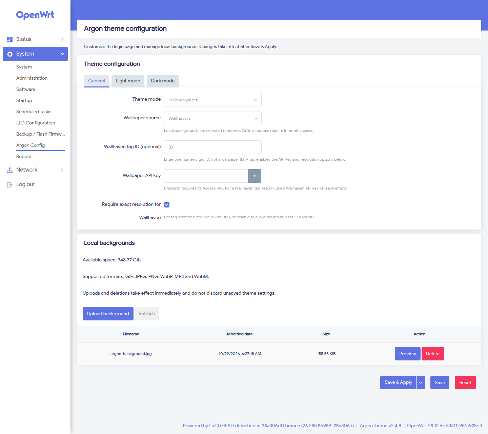
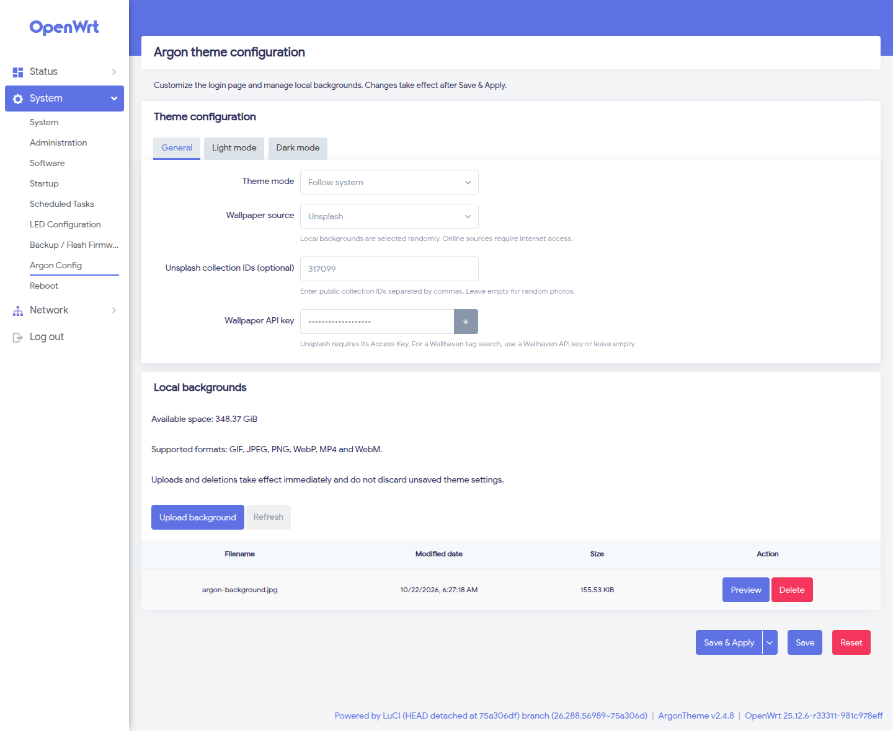
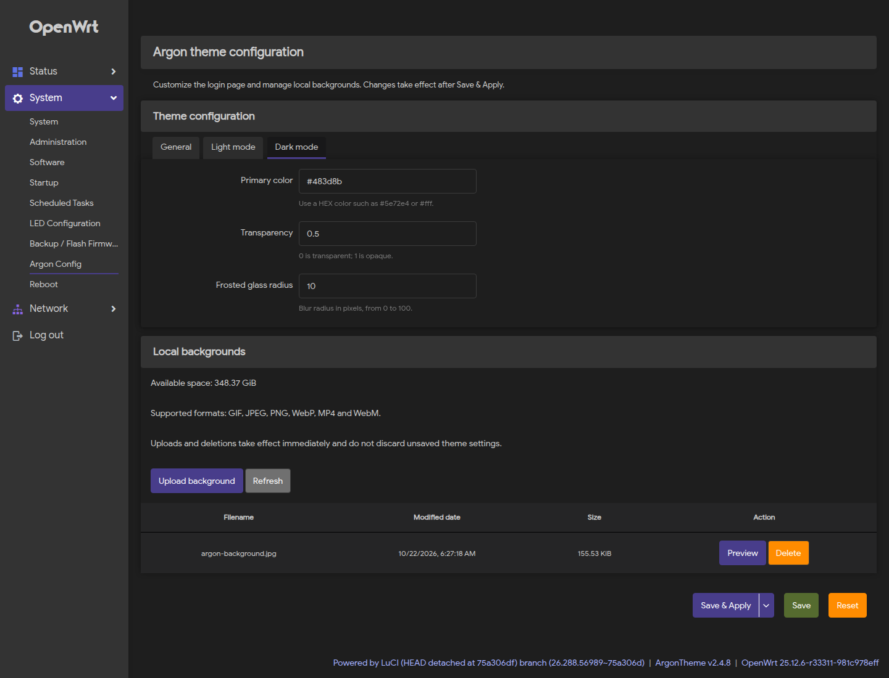
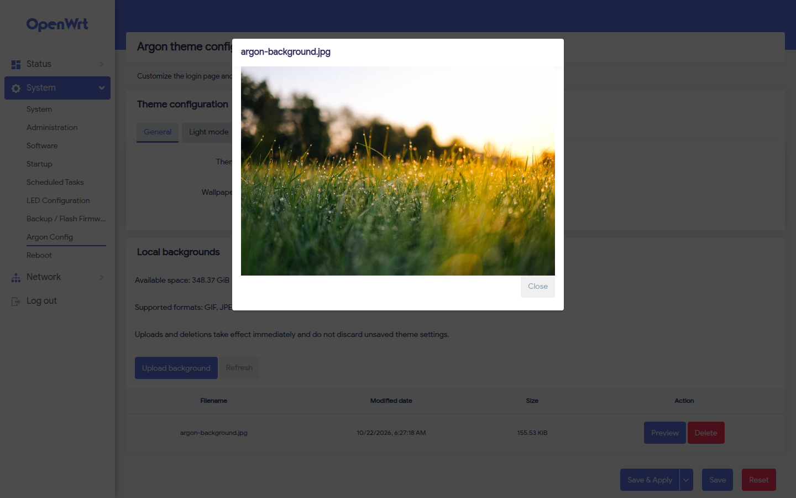

# Argon theme configuration

English | [简体中文](README_ZH.md)

An independent project based on [jerrykuku/luci-app-argon-config](https://github.com/jerrykuku/luci-app-argon-config), rebuilt for current stable OpenWrt and JavaScript LuCI. This repository is maintained separately from the upstream fork network.

## Compatibility

| Target | Behavior |
| --- | --- |
| OpenWrt 25.12.6 / LuCI 25.12 | Primary target; native APK build |
| OpenWrt 24.10.8 / LuCI 24.10 | IPK compatibility build |
| Argon 2.x | Standalone settings under System → Argon Config |
| Argon 3.x with the `config-integrated` marker | Uses the theme's integrated settings; standalone menu is hidden |

**Argon 3.0 includes its own settings. Fresh installations generally do not need this plugin.** Separate view, RPC, menu and translation names prevent file ownership conflicts with the integrated theme. The plugin does not modify the theme; online wallpaper availability depends on the theme and network.

## Features

- General, light and dark settings tabs with color and numeric validation.
- Standard LuCI Save, Save & Apply and Reset actions.
- Unsplash collection filters and Wallhaven tag, API key and resolution settings on compatible themes.
- Image/video uploads, previews, confirmed deletion and available storage display.
- File list updates preserve unsaved settings.
- Duplicate uploads are rejected, failures are reported, and read-only users cannot change files.
- Existing configuration is preserved during upgrades, including migration of the legacy Bing switch.

## Online wallpaper filters (2.1.0)

The standalone settings page now supports Unsplash collection IDs, a numeric Wallhaven tag ID, optional Wallhaven API keys, and exact/minimum 1920x1080 tag searches. Existing encoded settings are read without losing IDs, and filters are kept when switching sources. These controls use the wallpaper RPC in Argon 2.4.8 or a compatible theme; Argon 3 uses its own settings page. See [filter behavior and compatibility](docs/ONLINE_WALLPAPER.md).

## Screenshots

Captured from version 2.1.0 on OpenWrt 25.12.6 / LuCI 25.12 with Argon 2.4.8 and demo settings. Argon 3 uses its integrated settings page instead.

**Wallhaven filters and local background management** — set a numeric tag, choose exact or minimum resolution, and upload, preview or delete local files.



<details>
<summary>More screenshots: Unsplash collections, dark appearance and background preview</summary>

**Unsplash collections** — select a public collection and enter your Unsplash Access Key. The masked key shown here is a demo value.



**Dark appearance** — configure the dark mode primary color, transparency and frosted glass radius.



**Background preview** — inspect an uploaded image before using it on the login page.



</details>

## Installation

Install a compatible Argon theme first and back up `/etc/config/argon`. Download the APK or IPK files from the latest [release](https://github.com/AimeeAngelia/luci-app-argon-config/releases/latest), then upload them to `/tmp`. Each release includes the main package, optional translations and `SHA256SUMS`. Development builds are also available as ZIP artifacts in [Actions](https://github.com/AimeeAngelia/luci-app-argon-config/actions).

OpenWrt 25.12:

```sh
apk add --allow-untrusted /tmp/luci-app-argon-config-2.1.0-r1.apk
# Optional Simplified Chinese translation
apk add --allow-untrusted /tmp/luci-i18n-argon-config-app-zh-cn-2.1.0-r1.apk
```

OpenWrt 24.10:

```sh
opkg install /tmp/luci-app-argon-config_2.1.0-r1_all.ipk
opkg install /tmp/luci-i18n-argon-config-app-zh-cn_2.1.0-r1_all.ipk
```

Use the actual filenames from your build. Translations now use `luci-i18n-argon-config-app-*` to avoid colliding with Argon 3.x translations. Log in to LuCI again after installation. The standalone page is `/cgi-bin/luci/admin/system/argon-config-app`. To use uploaded backgrounds, choose the local wallpaper source and Save & Apply. The theme randomly selects from multiple local files.

This plugin does not migrate the theme itself. Follow the [theme migration instructions](https://github.com/jerrykuku/luci-theme-argon#readme) when upgrading Argon 2.x to 3.x.

## Building

Add this repository and the Argon theme to a matching OpenWrt SDK/buildroot, select `LuCI → Applications → luci-app-argon-config`, and run:

```sh
make package/luci-app-argon-config/compile V=s
```

The SDK selects APK or IPK. Do not also include Argon 3's `compat/luci-app-argon-config` recipe with the same package name. See [development and validation](docs/DEVELOPMENT.md) for Docker builds and tests. CI builds both formats. Pushing a version tag such as `v2.1.0` publishes both formats to Releases after all checks pass. The Release workflow can also be run manually with a matching tag name. APK and IPK are distributed as release assets because [GitHub Packages does not provide a native registry for these formats](https://docs.github.com/en/packages/learn-github-packages/introduction-to-github-packages#support-for-package-registries).

Based on work by Jerrykuku and the original contributors, under Apache-2.0. [Argon theme upstream](https://github.com/jerrykuku/luci-theme-argon).
