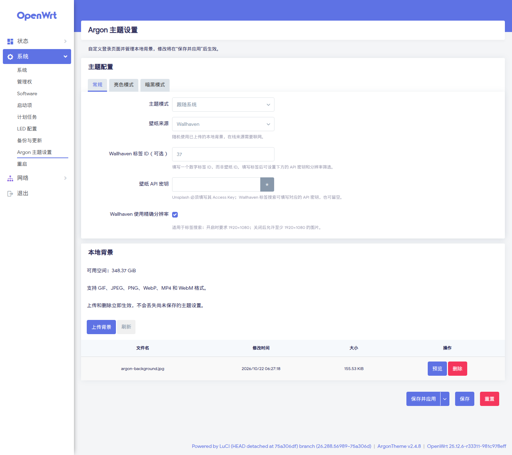
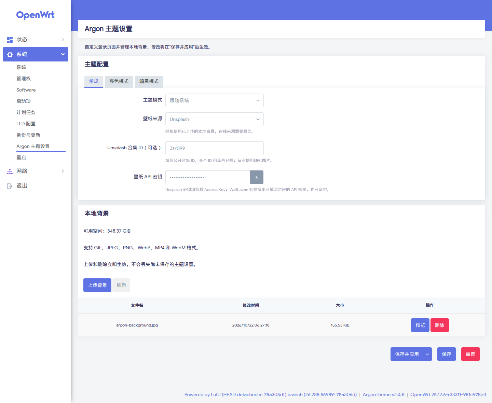
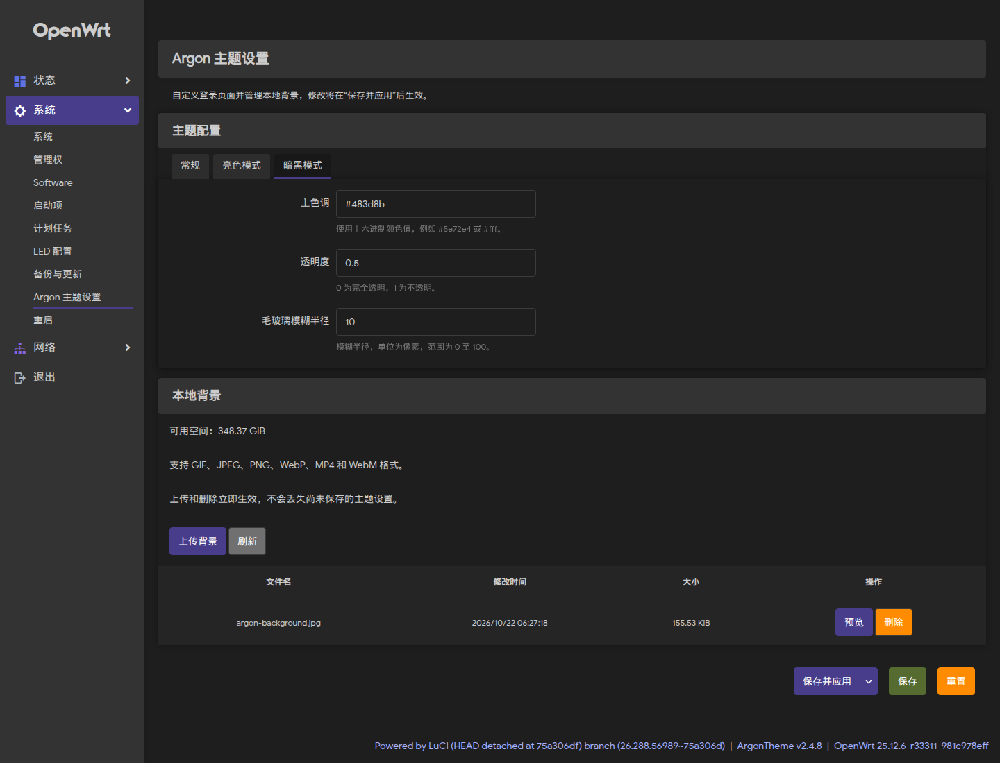
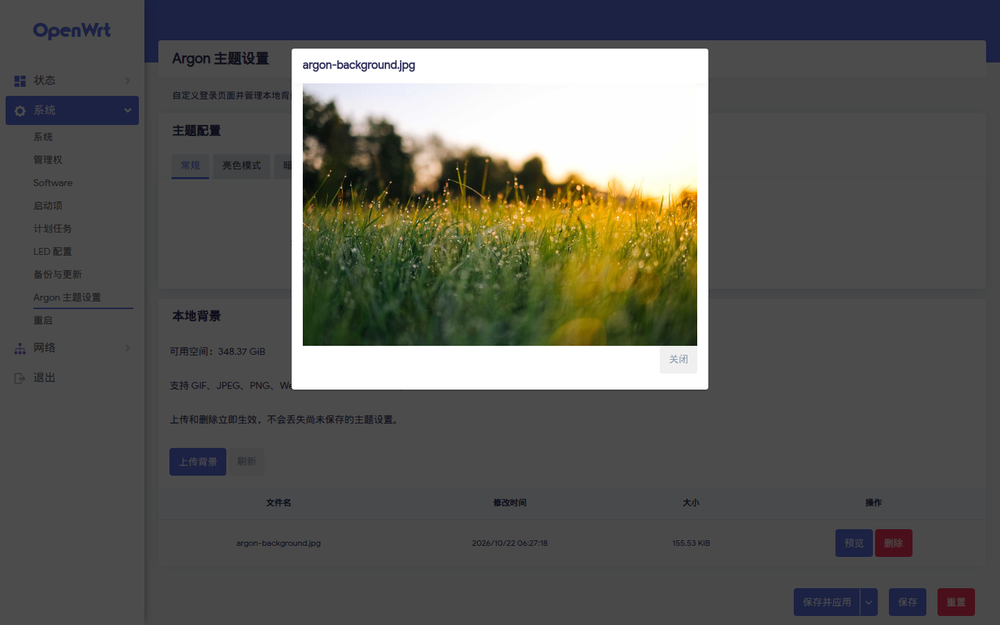

# Argon 主题设置插件

[English](README.md) | 简体中文

这是基于 [jerrykuku/luci-app-argon-config](https://github.com/jerrykuku/luci-app-argon-config) 持续维护的独立项目，已脱离 GitHub 复刻网络。项目针对当前正式版 OpenWrt 和 JavaScript LuCI 重构，支持 APK 和 IPK。

## 兼容性

| 系统或主题 | 行为 |
| --- | --- |
| OpenWrt 25.12.6 / LuCI 25.12 | 主要目标，SDK 构建 APK |
| OpenWrt 24.10.8 / LuCI 24.10 | 兼容构建 IPK |
| Argon 2.x | 使用本插件的“系统 → Argon 主题设置”页面 |
| Argon 3.x，带 `config-integrated` 标记 | 使用主题内置的设置页面，本插件自动隐藏入口 |

**Argon 3.0 已内置设置，新安装通常无需此插件。** 本项目的独立页面、RPC、菜单和语言包使用独立名称，避免与新主题争用文件。不会修改主题代码；在线壁纸是否可用由主题实现和网络决定。

## 功能

- 常规、亮色、暗色设置分栏；校验颜色、透明度和模糊半径。
- 使用 LuCI 标准的“保存”“保存并应用”“重置”流程。
- 在兼容主题中设置 Unsplash 合集，以及 Wallhaven 标签、API 密钥和分辨率筛选。
- 上传图片、视频，预览背景，确认删除，查看剩余空间。
- 上传和删除后刷新文件列表，不整页重载，不丢失未保存的表单。
- 上传重名时拒绝覆盖，失败时显示原因；只读账户不能修改文件。
- 升级保留现有配置，迁移旧版 `bing_background` 设置。

## 在线壁纸筛选（2.1.0）

独立设置页面新增 Unsplash 合集 ID、Wallhaven 数字标签 ID、可选 API 密钥，以及标签搜索的精确／最低 1920×1080 分辨率设置。兼容已有编码配置，切换来源时保留筛选值。这些控件使用 Argon 2.4.8 或兼容主题的壁纸 RPC；Argon 3 继续使用主题内置设置。详见[筛选规则与兼容性](docs/ONLINE_WALLPAPER.md)。

## 界面截图

以下为 2.1.0 在 OpenWrt 25.12.6 / LuCI 25.12、Argon 2.4.8 下的实际界面，使用演示配置。Argon 3 使用主题内置设置页面。

**Wallhaven 筛选与本地背景管理**：设置数字标签，选择精确或最低分辨率，并上传、预览、删除本地背景。



<details>
<summary>展开更多截图：Unsplash 合集、暗色外观与背景预览</summary>

**Unsplash 合集**：选择公开合集并填写 Unsplash 应用的 Access Key；截图中的隐藏密钥为演示值。



**暗色外观**：分别设置暗色模式的主题色、透明度和毛玻璃半径。



**背景预览**：上传后直接查看图片，再决定是否用于登录页。示例图片来自 Argon 主题内置背景。



</details>

## 安装与升级

先备份配置，并安装与你系统兼容的 Argon 主题：

```sh
cp -p /etc/config/argon /tmp/argon.backup
```

从[最新发行版](https://github.com/AimeeAngelia/luci-app-argon-config/releases/latest)直接下载 APK 或 IPK，上传到路由器 `/tmp`。每次发行包含主包、可选语言包及 `SHA256SUMS` 校验文件。开发构建仍可在 [Actions](https://github.com/AimeeAngelia/luci-app-argon-config/actions) 中下载 ZIP 附件。

OpenWrt 25.12：

```sh
apk add --allow-untrusted /tmp/luci-app-argon-config-2.1.0-r1.apk
# 可选：简体中文语言包，文件名以实际产物为准
apk add --allow-untrusted /tmp/luci-i18n-argon-config-app-zh-cn-2.1.0-r1.apk
```

OpenWrt 24.10：

```sh
opkg install /tmp/luci-app-argon-config_2.1.0-r1_all.ipk
opkg install /tmp/luci-i18n-argon-config-app-zh-cn_2.1.0-r1_all.ipk
```

语言包名称改为 `luci-i18n-argon-config-app-*`，以免与 Argon 3.x 的语言包同名。旧插件升级时，安装脚本会先保存配置，再交给新的初始化脚本恢复。使用新版主题时也保留配置；主题负责自己的配置文件。

安装后重新登录 LuCI。旧主题的入口路径为 `/cgi-bin/luci/admin/system/argon-config-app`。若使用本地背景，将壁纸来源设为“本地背景”，再点击“保存并应用”。有多张背景时由主题随机选择。

插件不会负责把旧 Argon 2.x 主题迁移成 Argon 3.x；升级主题请遵循[主题的迁移说明](https://github.com/jerrykuku/luci-theme-argon#readme)。

## 从源码构建

放入匹配版本的 OpenWrt SDK/buildroot，另行加入 Argon 主题源码：

```sh
git clone https://github.com/AimeeAngelia/luci-app-argon-config.git package/luci-app-argon-config
make menuconfig  # LuCI → Applications → luci-app-argon-config
make package/luci-app-argon-config/compile V=s
```

生成 APK 或 IPK 由 SDK 决定，不要手工改扩展名。不要同时加入 Argon 3 源码下同名的 `compat/luci-app-argon-config` 迁移包。

Docker 构建及验证方法见 [开发说明](docs/DEVELOPMENT.md)。CI 同时构建两种格式。推送与 Makefile 版本对应的标签（例如 `v2.1.0`）后，全部检查通过才会公开发布到 Releases；也可在 Release 工作流中手动填写标签发布。APK、IPK 使用发行附件分发，因为 [GitHub Packages 不提供这两种格式的原生仓库](https://docs.github.com/en/packages/learn-github-packages/introduction-to-github-packages#support-for-package-registries)。

## 致谢

基于 Jerrykuku 和原项目贡献者的工作，沿用 Apache-2.0 许可证。Argon 主题由[上游项目](https://github.com/jerrykuku/luci-theme-argon)维护。
